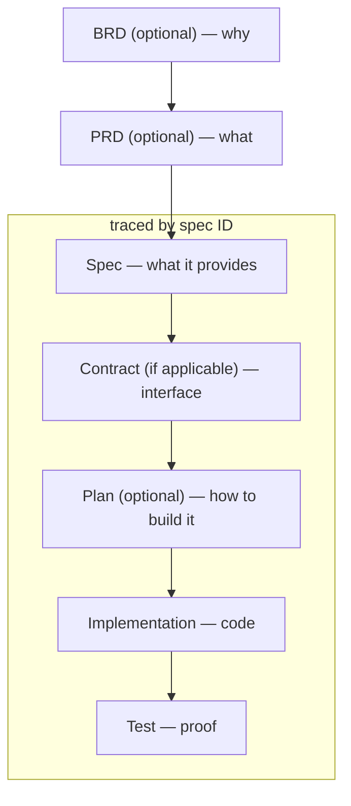
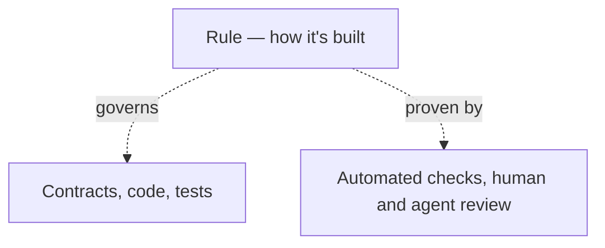

# spex

The AI-first development framework that turns natural specifications into deterministic code — keeping AI running at full speed, with humans safely in the driver’s seat.

_The name `spex` comes from a casual shorthand for specifications._

## Goal: unleash AI's full speed without slop

AI operates fast and getting even faster — the framework's job is unleash it speed while ensuring slop-free results.

## Core Concepts

spex is built on four simple pieces:

- **Specs** define _what_ a feature does — a capability with acceptance criteria.
- **Rules** govern _how_ everything is built — cross-cutting conventions like style, security, or testing that apply repo-wide.
- **Skills** are the instructions an AI agent follows to do the job — taking all applicable rules and implementing a spec.
- **Traceability** is the thread that stitches together spec, contract, implementations, and tests — ensuring full coverage and tracing for spec and every acceptance criterion.

## Quickstart

### Prerequisites

- **Rust**: [Install Rust](https://rust-lang.org/tools/install/) (required for building the spex CLI)
- **Git**: [Install Git](https://git-scm.com/install/)
- **spex CLI**: Clone spex repository (repo) and install spex cli tool:
  ```sh
  git clone https://github.com/foreachpartners/spex
  cd spex
  cargo install --path . --force
  ```

#### Setup

We will create the following structure:

```
shopping-notes/                       # workspace root
├── shopping-notes-api/                # existing api repository
├── shopping-notes-frontend/           # existing frontend repository
├── ...                                # repeat for other repositories
└── shopping-notes-spex/               # new spex repository (created by spex cli)
```

Repository directories follow `<project-name>-<repository-short-name>` (naming-convention), so rename existing repositories to match before running `spex init`.

1. Put all project git repos in one shared folder (workspace root folder)
2. Run terminal command `spex init` in workspace root to create the `shopping-notes-spex` repo
3. Open workspace to work across all repositories at once and integrate with AI coding agent:
   - Cursor/VSCode: open workspace from file `shopping-notes-spex/shopping-notes.code-workspace`
   - Cursor agentic: open workspace file in editor mode first, then pick it in agentic mode.
   - Claude CLI: run `claude --add-dir ../shopping-notes-api ../shopping-notes-frontend ..` from `shopping-notes-spex` repo
   - Zed: add project, pick all workspace repos (folders)
4. Run your first agent skill (skill) `/spex-setup` in the AI chat window to complete setup. Skills will be detected by the AI coding agent (agent) if the setup is done right.

### Adoption

After setup is completed you get basic skills and rules which you can customize for your project or leave them as is to be synced from upstream.

For existing project you can generate all specs based on existing code or gradually add them based on features you are working on. For example if you want to change user nickname registration length, ask AI to generate spec based on how user registration currently works, then do your changes.

### Typical workflow

Say you're want to add shopping item creation functionality to the backend. Here's what you will do:

1. **Create spec** `/spex-spec backend add shopping item endpoint`. Will create `shopping-notes-spex/specs/add-shopping-item.yaml`
2. **Derive the contract** for a spec `/spex-contract add-shopping-item`. Will add the endpoint to `shopping-notes-spex/contracts/api.openapi.yaml`.
3. **Implement it** `/spex-implement add-shopping-item`. Will implement a spec as writen following applicable rules and skill instructions.
4. **Review** review implementation with `/spex-review add-shopping-item` to ensure conformance with spec and applicable rules.
5. **Add tests** `/spex-test add-shopping-item`. Will add tests coverage for the implemented spec.

Tip: you can combine skills `/spex-spec /spex-contract` or run `spex-assembly-line` to implement, review and fix in loop and test.

Say you're want to add rule. Here's what you will do:

**Create a rule**: `/spex-rule secret handling`. Will create `shopping-notes-spex/rules/secret-handling.yaml` with scripts to verify it.

## Framework Principles

- **AI over Manual Coding**: used right, AI writes code faster than a developer while keeping quality high.
- **Specs over Guesswork**: clear, well-defined specs eliminate guesswork, giving explicit acceptance criteria for both AI and developer.
- **Rules over Tribal Knowledge**: cross-cutting conventions are captured as rules instead of living as tribal knowledge.
- **Human in control**: AI writes everything — specs, contracts, plans, code, and tests — and the human validates everything.
- **Deterministic enforcement**: every check that can be a script must be a script, proving the change does what the spec demands.
- **Traceability**: every behavioral change traces to a spec, bidirectionally — spec -> contract -> code -> test, and back.

See full principles in [framework-principles.md](docs/framework-principles.md).

## Description

### The flow from business goal to verified code:

For example, a shopping item feature moves through the flow like this:

1. **BRD** — help shoppers keep track of what to buy to increase engagement
2. **PRD** — users can add shopping items on the website
3. **Spec** — `add-shopping-item`: Customer can add a shopping item.

   Acceptance criteria:
   - MUST return 201 from POST /items with the created item
   - MUST let the customer add the item from the shopping notes page

4. **Contract** — OpenAPI definition of `addItem` returning `201`, plus a Figma reference for the shopping notes page
5. **Implementation** — the `addItem()` handler in code
6. **Test** — verifies that adding an item returns `201`



### Rules live outside the feature flow — they govern how every artifact is built:

For example, the rule `secret-handling` works like this:

1. **Rule** — `secret-handling`: "Secret protection"
2. **Governs** — every contract, file, and test in the repo, regardless of feature
3. **Proven by** — a secret scan check running in CI or manually with `spex check`

Even if a deterministic check is not possible, rules are read and followed by AI and can be used for a review by a human or another agent, which gives pretty good results.



## Learn more

Framework [specification](docs/specification.md).

Example [project](examples/shopping-notes/README.md) with spex implemented.

## Try tutorial

Ready to try it yourself? Follow the [Tutorial](docs/tutorial.md) to take the
`shopping-notes` example from a plain multi-repo project to a fully spec-driven
workspace, end to end.
