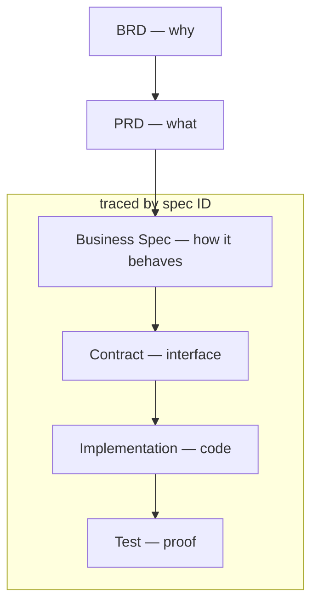
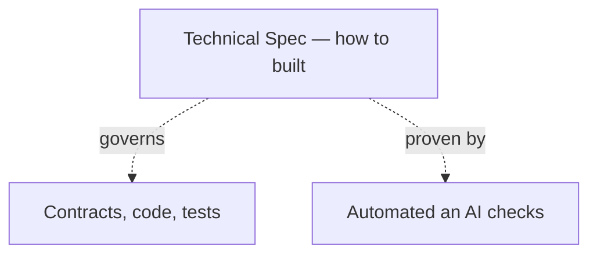

# spex

AI-first specification-driven development framework with human in control.

_The name `spex` comes from a casual shorthand for specifications._

## Prerequisites

- **Rust**: [Install Rust](https://rust-lang.org/tools/install/) (required for building the spex CLI)
- **Git**: [Install Git](https://git-scm.com/install/)
- **spex CLI**: Clone spex repository (repo) and install spex cli tool:
  ```sh
  git clone https://github.com/ziimakc/spex
  cd spex
  cargo install --path . --force
  ```

## Quickstart

### See also

- [Glossary](docs/glossary.md)

### Setup

We will create the following structure:

```
pepperoni-pizza/         # workspace root
├── api/                 # existing api repository
├── frontend/            # existing frontend repository
├── ...                  # repeat for other repositories
└── spex/                # new spex repository (created by cli)
    └── pepperoni-pizza.code-workspace  # editor workspace file
```

1. Put all project git repos in one shared folder (workspace root folder)
2. Run `spex init` in workspace root to create `pepperoni-pizza/spex` repo
3. Open workspace to work across all repositories at once:
   - Cursor/VSCode: open workspace from file `spex/pepperoni-pizza.code-workspace`
   - Claude CLI: run `claude --add-dir ../api ../contracts ../frontend ..` from `spex` repo
   - Zed: add project, pick all workspace repos (folders)
4. Run your first agent skill (skill) `/spex-setup` to complete setup

### Workflow

Workflow core is AI agent skills and CLI commands

1. Create your first specification (spec):
   - business spec `/spex-create-biz [backend order pizza endpoint]`. Will create `spex/biz-specs/BIZ-ORDER-PIZZA.yaml`
   - technical spec `/spex-create-tech [secret protection]`. Will create `spex/tech-specs/TECH-SECRET-PROTECTION.yaml`
2. Create implementation plan for spec `/spex-create-plan [secret protection]`. Will create `spex/plans/TECH-SECRET-PROTECTION.md`
3. Execute plan`/spex-execute-plan [secret protection]`. Will execute `TECH-SECRET-PROTECTION.md` plan using multiple agents working in parallel per step.
4. Check result with `spex check`. Will run all related TECH spec checks related to your changes.

## Why

**AI over Manual Coding**: Used right, AI writes code faster than a developer while keeping quality high. It's cheap — it can even run locally for the price of electricity — and it keeps getting faster and better over time. Developers who insist on writing every line by hand will simply lose the competition.

**Specs over Guesswork**: Casual requests force an AI to guess, leading to inaccurate repository navigation and assumption-based task completion. Clear, well-defined business specifications (`BIZ`) eliminate guesswork, providing explicit acceptance criteria for both the AI to follow and the developer to verify. Specs will stay relevant for a long time even if AI becomes much better and faster because you need to describe an idea from your head that will meet your/customer expectations and not someone else.

**Technical rules and patterns as Specs**: Cross-cutting technical rules and patterns — code style, structure, testing, security — are captured as technical specs (`TECH`) instead of living as tribal knowledge to ensure project maintainability over long time. They apply repo-wide and are proven by automated checks (linters, CI gates) or AI, so every change follows the same rules no matter who — human or AI model — writes the code.

**Human in control**: Vibe coding ships working code fast, but every unreviewed decision adds mess that compounds — eroding maintainability and trust in the codebase. With spex, the human stays in control: specs and contracts are reviewed and approved before implementation, and tests prove the result. The codebase stays maintainable, and every change traces back to a decision a human approved.

## Framework Principles

**Simplicity**: The tool should help the developer get work done, not stand in the way. Everything about spex is kept simple, so it can be adopted and put to use in five minutes.

**Tool-agnostic**: To avoid lock-in and restrictions, the framework works with any IDE, terminal, or AI model.

## Description

### The flow from business goal to verified code:

For example, a pizza ordering feature moves through the flow like this:

1. **BRD** — "sell pizza online to increase sales"
2. **PRD** — "customers can pick a pizza on the website and pay online"
3. **Business Spec** — `BIZ-PLACE-PIZZA-ORDER`: "POST /orders returns 201 with the created order"
4. **Contract** — OpenAPI definition of `placeOrder` returning `201`
5. **Implementation** — the `placeOrder()` handler in code
6. **Test** — verifies that placing an order returns `201`



### Technical specs live outside the feature flow — they govern how every artifact is built:

For example, the rule `TECH-SECRET-HANDLING` works like this:

1. **Technical Spec** — `TECH-SECRET-HANDLING`: "no secrets in the repository"
2. **Governs** — every contract, file, and test in the repo, regardless of feature
3. **Proven by** — a secret scan check passing on every commit in CI


