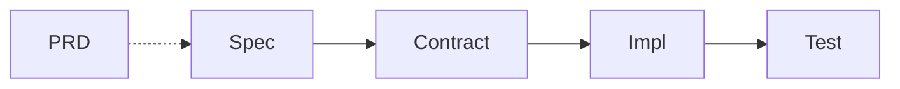

# 🦉 Main spex

The AI-first development framework that turns specifications into verified code — keeping AI running at full speed while ensuring slop-free results.

_The name `spex` comes from a casual shorthand for specifications._

## At a glance

- **Specs, not guesses** — acceptance criteria tell the AI exactly what to build.
- **Rules, enforced** — conventions are given to the agent as context and proven by `spex check`.
- **Skills, not prompts** — each workflow step is a written instruction, so the process is the same every time.
- **Coverage, proven** — every acceptance criterion is traced to its contract, code, and test, and `spex coverage` shows the gaps.
- **Human review where it counts** — you approve specs and contracts; checks, tests, and agent reviews cover the rest.
- **Tool-agnostic** — any AI model, coding agent, CLI, or IDE, and any language or framework.
- **Simple by design** — plain files and a small set of commands, easy to understand and use with minimal docs.
- **Easy to adopt** — start in minutes, on a new or existing codebase, one package and spec at a time, from solo projects to multi-team repos.

## Why spex

Ask an AI to write you a snake game and it will. But will the snake have big blue eyes and eat donuts, as you wanted? Unlikely — the AI fills every detail you left out with its own guesses, so you get the game it imagined, not the one you wanted.

AI writes code fast, but fast is not the same as right: it can add changes nobody asked for, forget requirements, do the same thing differently each time, or hallucinate. Every unreviewed decision and unverified result adds slop that compounds. Reviewing everything by hand throws away the speed; accepting everything ships the slop.

spex helps to produce slop-free, verifiable results fast, with minimal human intervention. The AI writes everything, following the specs, skills, and rules; the human decides and approves; and reviews, tests, and deterministic checks prove the result.

## Quickstart

In your project root, the folder that holds your packages:

```sh
spex init
```

Then run the skill in your AI coding agent chat to add the packages and complete the setup:

```text
/spex-setup add api and frontend
```

First time? Follow the step-by-step [Setup guide](docs/setup.md): prerequisites, install, layouts, and workspace.

## Typical workflow

Every artifact is traced back to its spec by the spec ID:



### PRD

Optional: the project's overall goal and main capabilities, the root the specs are broken down from. It keeps the why and the what, never the details:

```text
You: /spex-prd shopping notes app
AI:  Who uses it, and when?
You: A shopper in the store, checking what is left to buy.
AI:  Created shopping-notes-spex/docs/prd.md
     ✓ prd: docs/prd.md in spex.yaml
     ✓ Problem, Goal, Users, Success
     ✓ Capabilities: add item, view list, mark bought, delete item, clear list
     ✓ Non-goals: accounts and shared lists, quantities and prices
     Ready for your review!
```

### Feature

Adding shopping item creation to the backend of the [shopping-notes example](examples/shopping-notes/README.md):

```text
You: /spex-spec backend add shopping item endpoint
AI:  Should an item with an empty name be rejected?
You: Yes.
AI:  Created shopping-notes-spex/specs/api-add-shopping-item.yaml
     ✓ MUST create an item with the given `name` and `bought: false`
     ✓ MUST assign each created item a unique `id`
     ✓ MUST persist the created item so it survives an API restart
     ✓ MUST NOT create an item when `name` is missing or empty
     Ready for your review!

You: /spex-contract api-add-shopping-item
AI:  Updated shopping-notes-spex/contracts/api.openapi.yaml
     ✓ POST /items (createItem) — 201 Item, 422 ValidationError
     Ready for your review!

You: /spex-implement api-add-shopping-item
AI:  Read 1 spec and 7 rules for the api package.
     ✓ POST /items handler in shopping-notes-api/src/app.ts
     ✓ @spec impl annotations on all 4 acceptance criteria
     Spec status: in-progress

You: /spex-review api-add-shopping-item
AI:  Rules: 0 findings. Specs: 0 findings.

You: /spex-test api-add-shopping-item
AI:  Added shopping-notes-api/src/app.test.ts
     ✓ 4/4 acceptance criteria traced to contract, impl and test
     Spec status: active
```

<details>
<summary><strong>What do the specs actually look like?</strong></summary>

Plain YAML — a title and acceptance criteria stating what the system MUST, MUST NOT, SHOULD or MAY do, no special syntax to learn. Here's the file created above:

```yaml
id: api-add-shopping-item
title: Create a shopping item
description: >-
  Lets a client add an item to the shopping list so the user doesn't forget
  to buy it.
acceptance_criteria:
  - id: create-item-with-name
    must: "create an item with the given `name` and `bought: false` when `POST /items` is called with a non-empty `name`"
  - id: reject-empty-name
    must_not: create an item when `name` is missing or empty
packages:
  - api
status: active
contract: single
```

Your AI writes these; you review the spec and the contract before any code is written. Every criterion is then traced to its contract, code, and test by `@spec` annotations, and `spex coverage` shows what is still missing.

Tip: combine skills like `/spex-spec /spex-contract`, or run `/spex-assembly-line` to implement, review and fix in a loop, and then test.

</details>

### Rule

Adding a rule to ensure sensitive information is never committed:

```text
You: /spex-rule secret handling
AI:  Created shopping-notes-spex/rules/secret-handling.yaml
     ✓ MUST NOT hardcode secrets in source
     ✓ MUST NOT log secrets
     ✓ check no-secret-in-console-log
     ✓ check no-backup-files
     Ready for your review!
```

Rules live outside the feature flow — they govern how every artifact is built.

## Learn more

Product requirements, principles, and values in the [PRD](docs/prd.md).

Framework, CLI, and skill [specs](specs).

Example [project](examples/shopping-notes/README.md) with spex implemented.

## Try tutorial

Ready to try it yourself? Follow the [Tutorial](docs/tutorial.md) to take the
`shopping-notes` example from a plain multi-repo project to a fully spec-driven
project, end to end.
