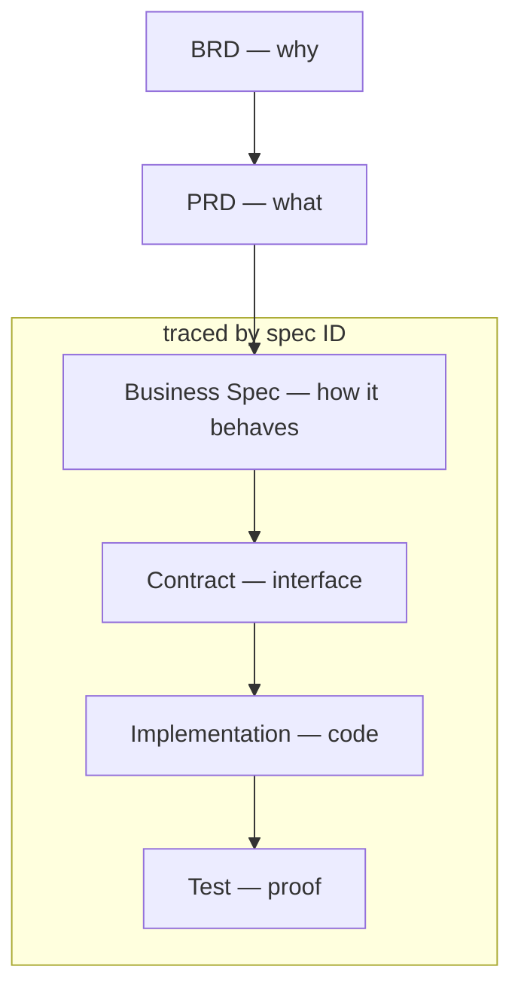
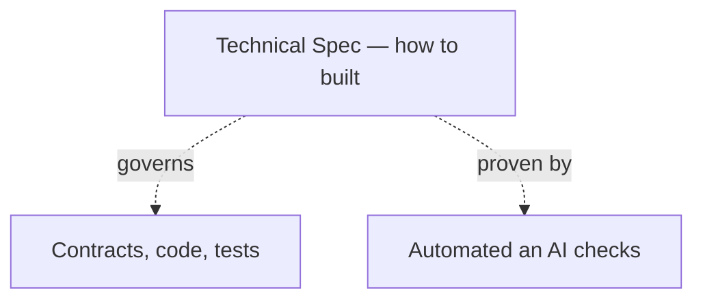

# spex

AI-first specification-driven development framework with human in control.

_The name `spex` comes from a casual shorthand for specifications._

## Prerequisites

- **Rust**: [Install Rust](https://rust-lang.org/tools/install/) (required for building the spex CLI)
- **Git**: [Install Git](https://git-scm.com/install/)
- **spex CLI**: Clone spex repository and install spex cli tool:
  ```sh
  git clone https://github.com/ziimakc/spex
  cd spex
  cargo install --path . --force
  ```

## Quickstart

## Setup

1. Put all project git repositories in one shared folder (workspace root folder)
2. Run `spex init` in workspace root to create `pepperoni-pizza/spex` repository

This creates the following structure:

```
pepperoni-pizza/         # workspace root
├── api/                 # existing api repository
├── frontend/            # existing frontend repository
└── spex/                # newly spex repository
    └── pepperoni-pizza.code-workspace  # editor workspace file
```

Open `spex/pepperoni-pizza.code-workspace` in your editor to work across every repository at once.

3. Run your first skill `/spex-setup`

### Workflow

Workflow cor is AI skills and CLI commands

1. Create your first

- business spec `/spex-create-biz [spec backend order pizza endpoint]`
- technical spec `/spex-create-tech [commit message format]`

2. Create implementation plan for spec `/spex-create-plan [for BIZ-PLACE-PIZZA-ORDER or commit message format]`
3. Execute plan with one or multiple agents working in parallel depending on plan `/spex-execute-plan`
4. Audit result with `spex check`

## Why

**AI over Manual Coding**: Used right, AI writes code faster than a developer while keeping quality high. It's cheap — it can even run locally for the price of electricity — and it keeps getting faster and better over time. Developers who insist on writing every line by hand will simply lose the competition.

**Specs over Guesswork**: Casual requests force an AI to guess, leading to inaccurate repository navigation and assumption-based task completion. Clear, well-defined business specifications (`BIZ`) eliminate guesswork, providing explicit acceptance criteria for both the AI to follow and the developer to verify. Specs will stay relevant for a long time even if AI becomes much better because you need describe an idea from your head thet will meet your expectations and not someone else.

**Technical rules and patterns as Specs**: Cross-cutting technical rules and patterns — code style, structure, testing, security — are captured as technical specs (`TECH`) instead of living as tribal knowledge to ensure project maintanability over long time. They apply repo-wide and are proven by automated checks (linters, CI gates) or AI, so every change follows the same rules no matter who — human or AI model — writes the code.

**Human in control**: Vibe coding ships working code fast, but every unreviewed decision adds mess that compounds — eroding maintainability and trust in the codebase. With spex, the human stays in control: specs and contracts are reviewed and approved before implementation, and tests prove the result. The codebase stays maintainable, and every change traces back to a decision a human approved.

## Description

### The flow from business goal to verified code:

For example, a pizza ordering feature moves through the flow like this:

1. **BRD** — "sell pizza online to increase sales"
2. **PRD** — "customers can pick a pizza on the website and pay online"
3. **Business Spec** — `BIZ-PLACE-PIZZA-ORDER`: "POST /orders returns 201 with the created order"
4. **Contract** — OpenAPI definition of `placeOrder` returning `201`
5. **Implementation** — the `placeOrder()` handler in code
6. **Test** — verifies that placing an order returns `201`



### Technical specs live outside the feature flow — they govern how every artifact is built:

For example, the rule `TECH-SECRET-HANDLING` works like this:

1. **Technical Spec** — `TECH-SECRET-HANDLING`: "no secrets in the repository"
2. **Governs** — every contract, file, and test in the repo, regardless of feature
3. **Proven by** — a secret scan check passing on every commit in CI


