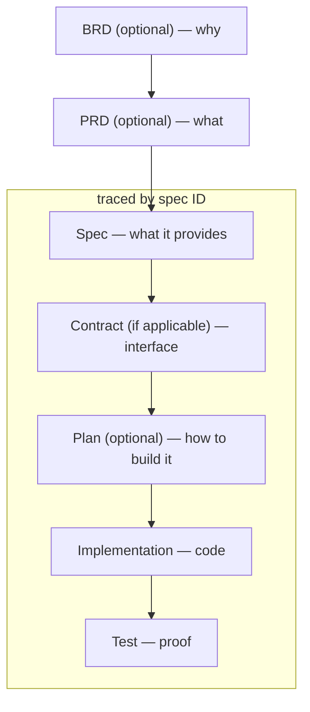
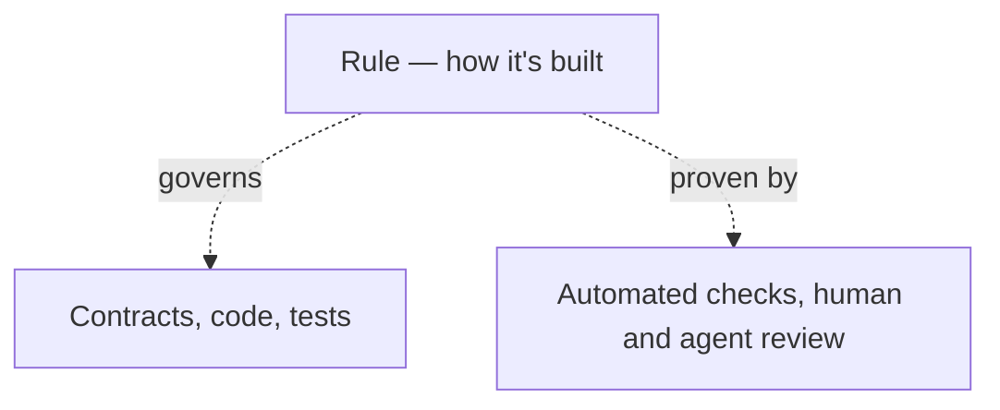

# 🦉 Main spex

The AI-first development framework that turns natural specifications into deterministic code — keeping AI running at full speed while ensuring slop-free verifiable results.

_The name `spex` comes from a casual shorthand for specifications._

## Core Concepts

Main spex, or spex for short, is built on four simple pieces:

- **Specs** define _what_ a feature does — a capability with acceptance criteria. Specs are single source of truth for project - all behaviour, contracts, code, tests and other artifacts come from it and must adhere to it.
- **Rules** govern _how_ everything is built — cross-cutting conventions like style, security, or testing. Each repository must adhere to a list of rules applicable to it.
- **Skills** are the instructions an AI agent follows to do the job consistently and correctly.
- **Traceability** is the thread that stitches together spec, contract, implementations, and tests — ensuring full coverage and tracing for spec and every acceptance criterion.

spex provides the core flow plus skills and rules you can extend, adapt, or replace for your project needs. Whatever you don't customize updates with each new version, bringing you the latest improvements contributed by the community.

## Quickstart

### Prerequisites

- **Rust**: [Install Rust](https://rust-lang.org/tools/install/) (required for building the spex CLI)
- **Git**: [Install Git](https://git-scm.com/install/)
- **Linux or macOS**: on Windows, use [WSL](https://learn.microsoft.com/windows/wsl/install); see [supported platforms](docs/cli/install.md#supported-platforms)
- **spex CLI**: Clone the Main spex repository and install the `spex` CLI tool:
  ```sh
  git clone https://github.com/foreachpartners/main-spex
  cd main-spex
  cargo install --path . --force
  ```

#### Setup

We will create the following structure:

```
shopping-notes/                       # workspace root
├── shopping-notes-api/                # existing api repository
├── shopping-notes-frontend/           # existing frontend repository
├── ...                                # repeat for other repositories
└── shopping-notes-spex/               # new spex repository (created by spex cli)
```

Repository directories follow `<project-name>-<repository-short-name>` (naming-convention), so rename existing repositories to match before running `/spex-setup`.

1. Put all project git repos in one shared folder (workspace root folder)
2. Run terminal command `spex init` in workspace root to create the `shopping-notes-spex` repo
3. Open workspace to work across all repositories at once and integrate with AI coding agent (the workspace file lists only the spex repository until `/spex-setup` adds the others):
   - Cursor/VSCode: open workspace from file `shopping-notes-spex/shopping-notes.code-workspace`
   - Cursor agentic: open workspace file in editor mode first, then pick it in agentic mode.
   - Claude CLI: run `claude --add-dir ../shopping-notes-api ../shopping-notes-frontend ..` from `shopping-notes-spex` repo
   - Zed: add project, pick all workspace repos (folders)
4. Run your first agent skill (skill) `/spex-setup` in the AI chat window to add the workspace repositories and complete setup. Skills will be detected by the AI coding agent (agent) if the setup is done right.

### Adoption

After setup is completed you get basic skills and rules which you can customize for your project or leave them as is to be synced from upstream.

For existing project you can generate all specs based on existing code or gradually add them based on features you are working on. For example if you want to limit the shopping item name length, ask AI to generate spec based on how adding a shopping item currently works, then do your changes.

### Typical workflow

#### Feature

Say you want to add shopping item creation functionality to the backend. Here's what you will do:

1. **Create spec** `/spex-spec backend add shopping item endpoint`. Will create `shopping-notes-spex/specs/api-add-shopping-item.yaml`
2. **Derive the contract** for a spec `/spex-contract api-add-shopping-item`. Will add the `createItem` endpoint to `shopping-notes-spex/contracts/api.openapi.yaml`.
3. **Implement it** `/spex-implement api-add-shopping-item`. Will implement a spec as written following applicable rules and skill instructions.
4. **Review** review focused on implementation with `/spex-review api-add-shopping-item` to ensure conformance with spec and applicable rules.
5. **Add tests** `/spex-test api-add-shopping-item`. Will add tests coverage for the implemented spec and at the same time work as last verification layer.

Tip: you can combine skills `/spex-spec /spex-contract` or run `/spex-assembly-line` to implement, review and fix in loop and test.

#### Rule

Say you want to add a rule to ensure we don't commit sensitive information. Here's what you will do:

**Create a rule**: `/spex-rule secret handling`. Will create `shopping-notes-spex/rules/secret-handling.yaml` with checks to verify it.

## Framework Principles

- **AI over Manual Coding**: used right, AI writes code faster than a developer while keeping quality high.
- **Specs over Guesswork**: clear, well-defined specs eliminate guesswork, giving explicit acceptance criteria for both AI and developer.
- **Rules over Tribal Knowledge**: cross-cutting conventions are captured as rules instead of living as tribal knowledge.
- **Human in control**: AI writes everything — specs, contracts, plans, code, and tests — and the human validates everything.
- **Deterministic enforcement**: every check that can be a script must be a script, proving the change does what the spec demands.
- **Traceability**: every behavioral change traces to a spec, bidirectionally — spec -> contract -> code -> test, and back.

See full principles in [framework-principles.md](docs/framework-principles.md).

## Description

### The flow from business goal to verified code:

For example, the shopping item feature of the [shopping-notes example](examples/shopping-notes/README.md) moves through the flow like this:

1. **BRD** — let users note down shopping items so they don't forget to buy them when visiting a store
2. **PRD** — users manage a shopping list in the web app: add, view, mark as bought, delete, and clear items
3. **Spec** — [`api-add-shopping-item`](examples/shopping-notes/shopping-notes-spex/specs/api-add-shopping-item.yaml): Create a shopping item.

   Acceptance criteria:
   - MUST create an item with the given `name` and `bought: false` when `POST /items` is called with a non-empty `name`
   - MUST assign each created item a unique `id`
   - MUST persist the created item to the JSON file store so it survives an API restart
   - MUST NOT create an item when `name` is missing or empty

4. **Contract** — [OpenAPI definition](examples/shopping-notes/shopping-notes-spex/contracts/api.openapi.yaml) of `createItem` returning `201`, tagged `@spec contract api-add-shopping-item`. The frontend counterpart `fe-add-shopping-item` uses a [Figma reference](examples/shopping-notes/shopping-notes-frontend/contracts/figma.md) as its contract instead
5. **Implementation** — the `POST /items` handler in [`app.ts`](examples/shopping-notes/shopping-notes-api/src/app.ts), tagged `@spec impl api-add-shopping-item#create-item-with-name`
6. **Test** — [`app.test.ts`](examples/shopping-notes/shopping-notes-api/src/app.test.ts) verifies that an item is created with the given name and `bought: false`, tagged `@spec test api-add-shopping-item#create-item-with-name`



### Rules live outside the feature flow — they govern how every artifact is built:

For example, the rule [`secret-handling`](examples/shopping-notes/shopping-notes-spex/rules/secret-handling.yaml) works like this:

1. **Rule** — `secret-handling`: "Secret protection"
2. **Governs** — every contract, file, and test in the repo, regardless of feature
3. **Proven by** — checks such as `no-secret-in-console-log` and `no-backup-files` running in CI or manually with `spex check`

Even if a deterministic check is not possible, rules are read and followed by AI and can be used for a review by a human or another agent, which gives pretty good results.



## Learn more

Framework [specification](docs/specification.md).

Example [project](examples/shopping-notes/README.md) with spex implemented.

## Try tutorial

Ready to try it yourself? Follow the [Tutorial](docs/tutorial.md) to take the
`shopping-notes` example from a plain multi-repo project to a fully spec-driven
workspace, end to end.
