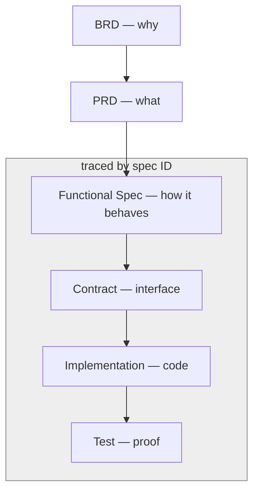
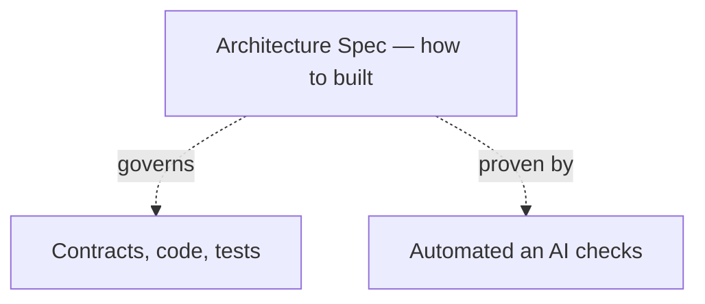

# spex

AI-first specification-driven development framework with human validation.

_The name `spex` comes from a casual shorthand for specifications._

## Why

**Specs over Guesswork**: Casual requests force an AI to guess, leading to inaccurate repository navigation and assumption-based task completion. Clear, well-defined functional specifications (`FUNC`) eliminate guesswork, providing explicit acceptance criteria for both the AI to follow and the developer to verify.

**Architecture as Specs**: Cross-cutting technical rules — code style, structure, testing, security — are captured as architecture specs (`ARCH`) instead of living as tribal knowledge. They apply repo-wide and are proven by automated checks (linters, CI gates) or AI, so every change follows the same rules no matter who — human or AI model — writes the code.

**Human validation**: Vibe coding ships working code fast, but every unreviewed decision adds mess that compounds — eroding maintainability and trust in the codebase. With spex, the human stays in control: specs and contracts are reviewed and approved before implementation, and tests prove the result. The codebase stays maintainable, and every change traces back to a decision a human approved.

## Workflow

### The flow from business goal to verified code:

### Architecture specs live outside the feature flow — they govern how every artifact is built:

