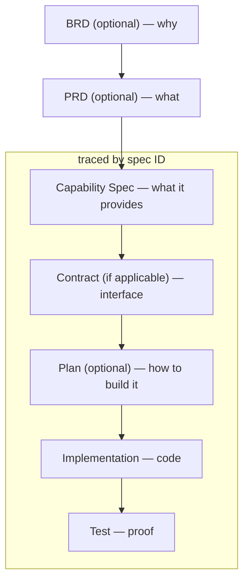
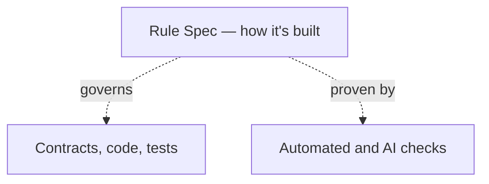

# spex

AI-first specification-driven development framework with human in control.

_The name `spex` comes from a casual shorthand for specifications._

## Goal

spex helps you move fast with AI, not stand in your way. Capability specs (CS) and rule specs (RS) give AI the context it needs to get the implementation right the first time — resulting in high-quality, maintainable code that's easy to change, with minimal or no rework of AI output.

## Quickstart

### Prerequisites

- **Rust**: [Install Rust](https://rust-lang.org/tools/install/) (required for building the spex CLI)
- **Git**: [Install Git](https://git-scm.com/install/)
- **spex CLI**: Clone spex repository (repo) and install spex cli tool:
  ```sh
  git clone https://github.com/ziimakc/spex
  cd spex
  cargo install --path . --force
  ```

#### Setup

We will create the following structure:

```
pepperoni-pizza/                       # workspace root
├── pepperoni-pizza-api/               # existing api repository
├── pepperoni-pizza-frontend/          # existing frontend repository
├── ...                                # repeat for other repositories
└── pepperoni-pizza-spex/              # new spex repository (created by cli)
    └── pepperoni-pizza.code-workspace # editor workspace file
```

Repository directories follow `<project-name>-<repository-short-name>` (RS-NAMING-CONVENTION), so rename existing repositories to match before running `spex init`.

1. Put all project git repos in one shared folder (workspace root folder)
2. Run terminal command `spex init` in workspace root to create the `pepperoni-pizza-spex` repo
3. Open workspace to work across all repositories at once and integrate with AI coding agent:
   - Cursor/VSCode: open workspace from file `pepperoni-pizza-spex/pepperoni-pizza.code-workspace`
   - Cursor agentic: open workspace file in editor mode first, then pick it in agentic mode.
   - Claude CLI: run `claude --add-dir ../pepperoni-pizza-api ../pepperoni-pizza-frontend ..` from `pepperoni-pizza-spex` repo
   - Zed: add project, pick all workspace repos (folders)
4. Run your first agent skill (skill) `/spex-setup` in the AI chat window to complete setup. Skills will be detected by the AI coding agent (agent) if the setup is done right.

### Workflow

Workflow core is AI agent skills and CLI commands.

1. Create your first specification (spec):
   - capability spec `/spex-capability-spec [backend place pizza order endpoint]`. Will create `pepperoni-pizza-spex/cs-specs/CS-PLACE-PIZZA-ORDER.yaml`
   - rule spec `/spex-rule-spec [secret handling]`. Will create `pepperoni-pizza-spex/rs-specs/RS-SECRET-HANDLING.yaml`
2. Derive the contract for a capability spec `/spex-contract [place pizza order]`. Will add the endpoint to `pepperoni-pizza-spex/contracts/api.openapi.yaml`.
3. Create an implementation plan for a spec `/spex-plan [secret handling]`. Will create `pepperoni-pizza-spex/plans/RS-SECRET-HANDLING/2024-11-25_secret-handling.md`
4. Execute the plan `/spex-execute [secret handling]`. Will execute the `RS-SECRET-HANDLING` plan using multiple agents working in parallel per step.
5. Check the results with `spex check`. Will run all rule spec (RS) checks related to your changes.
6. See coverage with `spex coverage`. Will check if all specs have a contract, implementation, and test.

Tip: you can combine skills `/spex-capability-spec /spex-contract /spex-plan`

## Framework Principles

**AI over Manual Coding**: Used right, AI writes code faster than a developer while keeping quality high. It's cheap — it can even run locally for the price of electricity — and it keeps getting faster and better over time. Developers who insist on writing every line by hand will simply lose the competition.

**Specs over Guesswork**: Casual requests force an AI to guess, leading to inaccurate repository navigation and assumption-based task completion. If I ask an AI to "make me a snake game", it will — but it will be the snake game the AI imagined, not the one I wanted, because I wanted a blue snake with big eyes! Clear, well-defined capability specifications (`CS`) eliminate guesswork, providing explicit acceptance criteria for both the AI to follow and the developer to verify. Specs will stay relevant for a long time even if AI becomes much better and faster, because you need to describe an idea from your head that will meet your expectations, not someone else's.

**Technical rules and patterns as Specs**: Cross-cutting technical rules and patterns — code style, structure, testing, security — are captured as rule specs (`RS`) instead of living as tribal knowledge to ensure project maintainability over the long term. They apply repo-wide and are proven by automated checks (linters, CI gates) or AI, so every change follows the same rules no matter who — human or AI model — writes the code. A one-off technical implementation — a specific endpoint, integration, or mechanism — is a capability spec (`CS`), not a rule spec.

**Human in control**: Vibe coding ships working code fast, but every unreviewed decision adds mess that compounds — eroding maintainability and trust in the codebase. With spex, the AI writes everything — specs, contracts, plans, code, and tests — and the human validates everything. The codebase stays maintainable, and every change traces back to a decision a human approved.

**Deterministic enforcement**: AI writes code fast, but along the way it may change things nobody asked it to and invent acceptance criteria that no spec actually contains. Human review alone can't catch all of it. Deterministic checks (tests, rule-spec checks, linting, schema validation, coverage) are what prove the change does what the spec demands and that nothing else broke. They give the same answer every time, so they catch what both the AI and the human overlook. That's why every check that can be a script must be a script.

See all principles in [framework-principles.md](docs/framework-principles.md).

## Description

### The flow from business goal to verified code:

For example, a pizza ordering feature moves through the flow like this:

1. **BRD** — sell pizza online to increase sales
2. **PRD** — customers can pick a pizza on the website and pay online
3. **Capability Spec** — `CS-PLACE-PIZZA-ORDER`: Customer can place an order.

   Acceptance criteria: POST /orders returns 201 with the created order

4. **Contract** — OpenAPI definition of `placeOrder` returning `201`
5. **Plan** — step-by-step build plan for the `placeOrder` endpoint
6. **Implementation** — the `placeOrder()` handler in code
7. **Test** — verifies that placing an order returns `201`



### Rule specs live outside the feature flow — they govern how every artifact is built:

For example, the rule `RS-SECRET-HANDLING` works like this:

1. **Rule Spec** — `RS-SECRET-HANDLING`: "Secret protection"
2. **Governs** — every contract, file, and test in the repo, regardless of feature
3. **Proven by** — a secret scan check passing on every commit in CI



## Learn more

Framework [specification](docs/specification.md).

Example [project](examples/pepperoni-pizza/README.md) with spex implemented.

## Try tutorial

Ready to try it yourself? Follow the [Tutorial](docs/tutorial.md) to take the
`pepperoni-pizza` example from a plain multi-repo project to a fully spec-driven
workspace, end to end.
