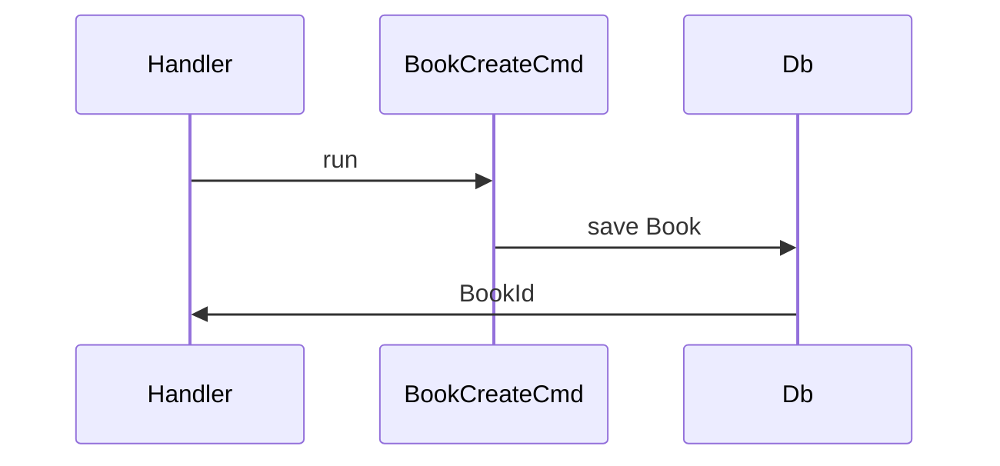

## Summary

1-2 sentences: why this change exists and what changed.

Smallest visual that makes the key point, next to the text it supports. Pick a call tree, file tree or component tree for structure, Mermaid for interaction. Keep only the calls, files and types the reviewer needs. Skip it when the change has nothing to show.

Call tree:

```text
book_create_handler
  BookCreateCmd::run
    Book::create
    db.book.save
  BookFetchOneQuery::run
```

File tree:

```text
src/
├── book/
│   ├── cmd.rs     # writes a Book
│   └── query.rs   # reads a BookView
```

Component tree, with the state and module boundaries that matter:

```text
<BookPage> (apps/web/src/routes/book.tsx)
  useBook()
  <BookToolbar>
    <PublishBookButton> (packages/ui)
```

Mermaid:



## Risk

Level and one line naming what in the change drives it, like **Medium** — changes pagination of the orders list, covered by tests.

- Low: docs, copy, tests, internal-only code, additive changes behind a flag. Can merge once checks are green.
- Medium: ordinary product changes. Standard review.
- High: security, auth, data migrations or deletion, CI or deploy config, changes that are hard to roll back. Careful review.

## Additional

Remove section if not applicable

Linked ticket(s) and any secondary changes or tasks bundled into this PR.

## Visual changes

Remove section if nothing visible changes

Before and after screenshots, or a recording for a multi-step flow
